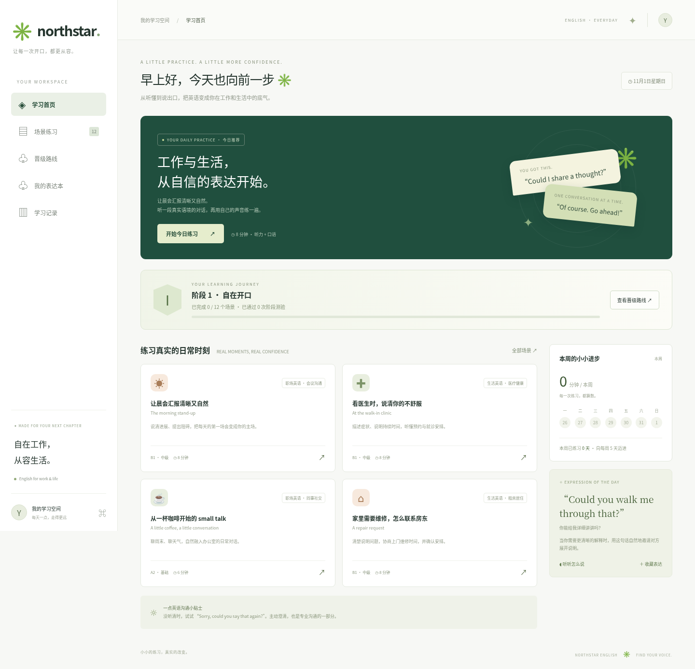
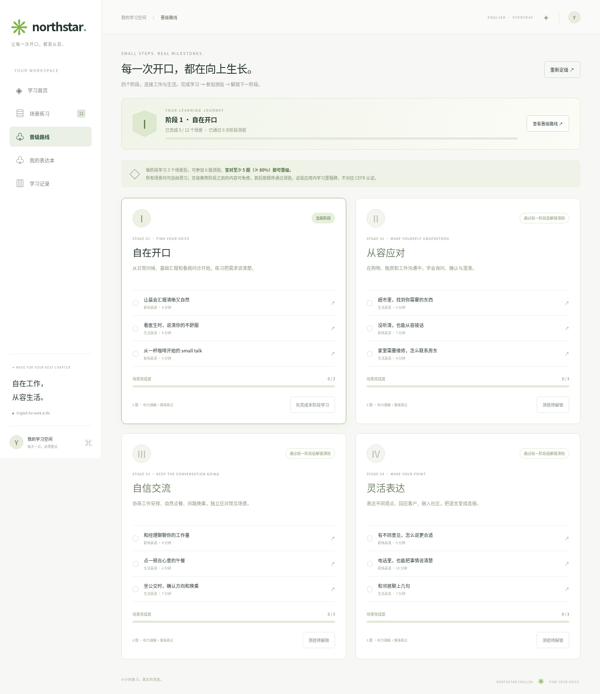

# Northstar · 工作与生活英语

面向希望提升工作与生活英语能力的中文使用者，练习职场与日常生活中的英语听力和口语。无框架、无第三方运行依赖的响应式网页版 MVP。

## 实际界面

以下截图由 Chromium 运行本项目生成，不是设计稿。



<details>
<summary>查看首次定级、晋级路线和手机版</summary>





</details>

## 在线使用（GitHub Pages）

代码已适配 GitHub Pages 的 `/learn-english/` 子路径，无需构建和后端服务。

仓库管理员首次需打开 **Settings → Pages → Build and deployment**：

1. Source 选择 **Deploy from a branch**。
2. Branch 选择 **master**，目录选择 **/ (root)**，点击 **Save**。
3. 等 GitHub Pages 部署完成后，使用页面给出的访问地址；此仓库的预期地址为 `https://jonney2021.github.io/learn-english/`。

发布云开发环境仅保存开发环境快照，不会自动推送 GitHub，也不会自动启用 GitHub Pages。仓库文件页展示源码和截图；交互应用需要通过 Pages 网站或本地服务打开。不要直接双击 HTML 文件，因为浏览器会限制本地文件的 JavaScript 模块加载。

## 启动

需要 Node.js 22 或更新版本。使用现有 checkout，不需要额外 worktree。

```sh
npm start
```

默认端口为 3000；可通过 `PORT` 环境变量更改。开发时修改源码后刷新浏览器即可。

```sh
npm run check
npm test
```

## 已实现

- 六个职场场景：晨会汇报、同事闲聊、礼貌澄清、表达不同意见、协商工作量、客户电话。
- 六个生活场景：诊所就诊、超市购物、租房报修、餐厅点餐、公共交通、邻里交流。
- 按职场、生活和具体主题筛选场景。医疗及交通对话仅为语言练习。
- 听对话、查看文本、调节语速、理解选择题、语音或文字回答、参考表达及关键词提示。
- 首次进入 8 题定级测试，按答对题数推荐四个阶段之一，也可从基础开始或重新定级。
- 四阶段晋级路线，职场与生活混合编排；每阶段 3 个场景、6 题测验，至少答对 5 题（80% 门槛）通过。
- 定级之前的阶段可免修复习；后续需完成场景并按顺序通过测验晋级。定级不伪造测验通过记录。
- 首页根据定级和晋级状态推荐当前阶段练习。场景筛选、表达收藏、按本地日期记录的学习历史和实际练习计时。
- 浏览器 localStorage 保存收藏与记录，不需要账户或后端数据库。

## 语音和隐私

使用 Web Speech API 合成语音，使用设备可用的英语声音。不是真人录音，具体声音取决于浏览器与设备。

语音识别取决于浏览器及其服务可用性。建议 Chrome；需要麦克风权限，部署时需 HTTPS（localhost 可本地开发）。浏览器可能发送音频至其供应商的识别服务。本应用不保存音频、口语文本或向自建服务器上传这些内容；localStorage 仅保存收藏、练习 ID、日期及分钟数、定级结果和阶段成绩。不支持识别时可输入文字完成练习。

定级仅为学习分流建议，阶段晋级是应用内里程碑，不对应 CEFR 认证或真实口语水平评定。

表达反馈只匹配参考关键词，不提供发音、语法或英语水平评分。当前没有 AI 对话、云同步或账户系统。后续可单独接入评测及对话服务。

字体可选加载 Google Fonts，离线时自动使用系统字体。
